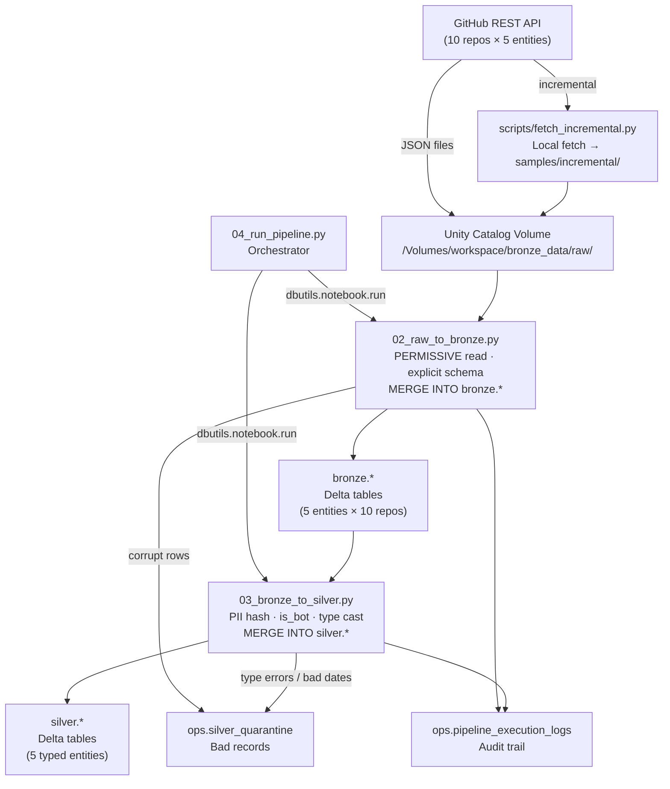

# DAV Database Trends — PySpark Medallion Pipeline

> **University Data Analysis & Visualization — Phase 2**  
> A production-grade PySpark Medallion pipeline (Bronze → Silver) on Databricks Free Edition,
> tracking 10 open-source database repositories via the GitHub REST API.

---

## Table of Contents

1. [Project Overview](#1-project-overview)
2. [Architecture](#2-architecture)
3. [Repository Layout](#3-repository-layout)
4. [Tracked Repositories](#4-tracked-repositories)
5. [Bronze Data Dictionary](#5-bronze-data-dictionary)
6. [Silver Data Dictionary](#6-silver-data-dictionary)
7. [Ops Tables](#7-ops-tables)
8. [Databricks Execution Guide](#8-databricks-execution-guide)
   - [8.7 Ingestion (API -> Volume) on Databricks](#87-ingestion-api---volume-on-databricks)
9. [How to Run the Pipeline](#9-how-to-run-the-pipeline)
   - [9.1 Incremental Load (Section A)](#91-incremental-load-section-a)
   - [9.2 Backfill of an Older Historical Period (Section B)](#92-backfill-of-an-older-historical-period-section-b)
   - [9.3 Idempotency Proof (Section D)](#93-idempotency-proof-section-d)
   - [9.4 Running Notebooks Standalone (02 & 03)](#94-running-notebooks-standalone-02_raw_to_bronzepy--03_bronze_to_silverpy)
   - [9.5 Schema Drift End-to-End Test (Section C)](#95-schema-drift-end-to-end-test-section-c)
10. [Idempotency & MERGE Strategy](#10-idempotency--merge-strategy)
11. [Schema Drift Handling](#11-schema-drift-handling)
12. [PII Handling](#12-pii-handling)
13. [Known Caveats](#13-known-caveats)
14. [Screenshots Checklist](#14-screenshots-checklist)

---

## 1. Project Overview

This pipeline ingests raw JSON from the **GitHub REST API** for 10 database repositories
(relational, document, key-value, vector) into a **Medallion architecture** on
Databricks Serverless with Unity Catalog and Delta Lake.

| Layer | Storage | Technology | Purpose |
|---|---|---|---|
| **Source** | GitHub REST API | `scripts/fetch_incremental.py` / `notebooks/00_ingest_github_api.py` | Pull raw JSON |
| **Bronze** | Unity Catalog Volume → Delta | `notebooks/02_raw_to_bronze.py` | Raw, schema-validated, idempotent |
| **Silver** | Unity Catalog Delta tables | `notebooks/03_bronze_to_silver.py` | Typed, PII-masked, deduplicated |
| **Gold** *(Phase 3)* | Unity Catalog Delta views | TBD | Star schema for BI/analytics |
| **Ops** | Unity Catalog Delta | `notebooks/01_setup.py` | Audit logs & quarantine |

**Design principles:**
- Zero schema inference — all `StructType` schemas are explicit in [`src/schemas.py`](src/schemas.py)
- Every record in Bronze and Silver carries a `load_timestamp`
- Idempotency via `MERGE INTO` (never append-only after table creation)
- PII masking with salted SHA-256 before data leaves Bronze
- Full audit trail in `ops.pipeline_execution_logs`

---

## 2. Architecture



---

## 3. Repository Layout

```
dav-database-trends/
├── notebooks/
│   ├── 00_ingest_github_api.py  # In-workspace GitHub REST API extraction
│   ├── 01_setup.py              # Create UC schemas, Delta tables, ops tables
│   ├── 02_raw_to_bronze.py      # Raw JSON → Bronze Delta (MERGE INTO)
│   ├── 03_bronze_to_silver.py   # Bronze → Silver (PII, is_bot, quarantine)
│   └── 04_run_pipeline.py       # Orchestrator (incremental / backfill / drift / idempotency)
├── src/
│   ├── schemas.py               # All explicit StructType schemas (Bronze + Silver + Ops)
│   ├── common.py                # Shared helpers: get_params, log_run, merge_delta, hash_email
│   └── ingestion/               # GitHub REST API client & helpers
│       └── github_client.py
├── scripts/
│   ├── full_load.py             # Historical full ingest → bronze/
│   ├── fetch_samples.py         # 5-record slice samples for testing
│   ├── fetch_incremental.py     # Incremental GitHub fetch → samples/incremental/
│   ├── make_drift_sample.py     # Inject schema-drift anomalies into samples/drift/
│   └── audit_bronze.py          # Bronze data quality audit script
├── samples/
│   ├── *.json                   # 5-record full-load slice (one repo)
│   ├── full_load/               # Full load samples (all entities)
│   ├── incremental/             # Output of fetch_incremental.py
│   ├── incremental_load/        # Incremental samples
│   └── drift/                   # Output of make_drift_sample.py (drift test data)
├── tests/
│   ├── check_schemas.py         # Validate schema fields against real JSON records
│   ├── test_schemas.py          # Unit tests for schema field coverage
│   ├── test_common.py           # Unit tests for common.py helpers
│   ├── test_github_client.py    # Unit tests for GitHub client & pagination
│   └── test_spark_logic.py      # Unit tests for PySpark parsing, timestamps, bots, drift
├── docs/
│   ├── data_dictionary.md       # Full data dictionary (extended)
│   ├── proof/                   # Proof of execution & rubric mapping
│   │   └── README.md
│   └── screenshots/             # Required Databricks screenshots (see checklist)
├── audit/
│   ├── bronze_quality_report.md # Full Bronze DQ audit
│   └── data_quality.md          # Bronze layer data quality audit report
└── progress.md                  # Project progress tracker
```

---

## 4. Tracked Repositories

| # | Repository | Category | Language | Notes |
|---|---|---|---|---|
| 1 | `postgres/postgres` | Relational | C | GitHub mirror — issues/PRs/releases disabled |
| 2 | `cockroachdb/cockroach` | Distributed SQL | Go | 41% bot commits (bors/TeamCity) |
| 3 | `mongodb/mongo` | Document | C++ | Issues tracked on external JIRA |
| 4 | `surrealdb/surrealdb` | Multi-model | Rust | — |
| 5 | `redis/redis` | Key-Value | C | — |
| 6 | `apache/cassandra` | Wide-Column | Java | Issues tracked on Apache JIRA |
| 7 | `facebookresearch/faiss` | Vector (CPU) | C++ | 27.8% unlinked authors (Meta internal emails) |
| 8 | `qdrant/qdrant` | Vector | Rust | GitHub start: 2021 |
| 9 | `milvus-io/milvus` | Vector | Go | — |
| 10 | `chroma-core/chroma` | Vector | Python | — |

---

## 5. Bronze Data Dictionary

All Bronze schemas are defined in [`src/schemas.py`](src/schemas.py) using explicit
`StructType`/`StructField`. Schema inference (`inferSchema`) is never used.
Every Bronze table adds `repo_full_name`, `load_timestamp`, `_source_file`, and `batch_id`
at ingest time. All Bronze schemas include `_corrupt_record` (StringType) for Spark PERMISSIVE mode.

**Schema Drift Absorption:** Unexpected new top-level JSON fields are dynamically discovered via `discover_drift_keys` and absorbed into target Bronze tables as nullable `STRING` columns using explicit DDL (`ALTER TABLE <target> ADD COLUMNS (<col> STRING)`) prior to Delta `MERGE INTO`, preventing silent data loss. Note: Drift-absorbed columns (such as `new_field_test`) appear as nullable `STRING` columns in the evolved Delta table and are intentionally not part of the declared schema in [`src/schemas.py`](src/schemas.py).

### 5.1 `bronze.commits`
Primary key: `(repo_full_name, sha)` · Date filter column: `commit.author.date`

| Column | Type | Nullable | PK | Description |
|---|---|---|---|---|
| `sha` | STRING | ✗ | ✓ | Full Git commit SHA |
| `node_id` | STRING | ✓ | | GitHub GraphQL node ID |
| `commit.author.name` | STRING | ✓ | | Author display name (dropped in Silver) |
| `commit.author.email` | STRING | ✓ | | Author email — PII hashed in Silver |
| `commit.author.date` | STRING | ✓ | | Commit author timestamp (ISO-8601) |
| `commit.committer.name` | STRING | ✓ | | Committer display name (dropped in Silver) |
| `commit.committer.email` | STRING | ✓ | | Committer email — PII hashed in Silver |
| `commit.committer.date` | STRING | ✓ | | Committer timestamp |
| `commit.message` | STRING | ✓ | | Full commit message — headline only kept in Silver |
| `commit.comment_count` | INTEGER | ✓ | | Number of commit comments |
| `commit.verification.verified` | BOOLEAN | ✓ | | GPG signature valid |
| `url` | STRING | ✓ | | GitHub commit REST API URL |
| `html_url` | STRING | ✓ | | GitHub web HTML URL |
| `comments_url` | STRING | ✓ | | Commit comments API URL |
| `author.login` | STRING | ✓ | | GitHub actor login |
| `author.id` | LONG | ✓ | | GitHub actor numeric ID |
| `author.type` | STRING | ✓ | | `"User"` or `"Bot"` |
| `committer.login` | STRING | ✓ | | GitHub committer login |
| `committer.type` | STRING | ✓ | | `"User"` or `"Bot"` |
| `parents` | ARRAY\<STRUCT\> | ✓ | | Parent commit SHAs |
| `repo_full_name` | STRING | ✗ | ✓ | Injected: `owner/repo` |
| `load_timestamp` | TIMESTAMP | ✗ | | Injected: batch ingest time (UTC) |
| `_source_file` | STRING | ✓ | | Injected: Volume file path |
| `batch_id` | STRING | ✓ | | Injected: pipeline run identifier |
| `_corrupt_record` | STRING | ✓ | | Spark PERMISSIVE mode: raw corrupt JSON |

### 5.2 `bronze.issues`
Primary key: `(repo_full_name, id)` · Date filter column: `updated_at`

| Column | Type | Nullable | PK | Description |
|---|---|---|---|---|
| `id` | LONG | ✗ | ✓ | GitHub issue numeric ID |
| `node_id` | STRING | ✓ | | GitHub GraphQL node ID |
| `url` | STRING | ✓ | | GitHub issue REST API URL |
| `repository_url` | STRING | ✓ | | Repository REST API URL |
| `labels_url` | STRING | ✓ | | Issue labels API URL |
| `comments_url` | STRING | ✓ | | Issue comments API URL |
| `events_url` | STRING | ✓ | | Issue events API URL |
| `html_url` | STRING | ✓ | | GitHub web HTML URL |
| `number` | INTEGER | ✗ | | Issue number (human-visible) |
| `state` | STRING | ✓ | | `"open"` or `"closed"` |
| `state_reason` | STRING | ✓ | | Closure reason |
| `locked` | BOOLEAN | ✓ | | Locked state |
| `title` | STRING | ✓ | | Issue title |
| `body` | STRING | ✓ | | Issue body text |
| `user.login` | STRING | ✓ | | Author GitHub login |
| `user.id` | LONG | ✓ | | Author GitHub ID |
| `user.type` | STRING | ✓ | | `"User"` or `"Bot"` |
| `labels` | ARRAY\<STRUCT\> | ✓ | | Label id, name, color |
| `assignee` | STRUCT | ✓ | | Primary assignee user struct |
| `assignees` | ARRAY\<STRUCT\> | ✓ | | Assignee user structs |
| `milestone.title` | STRING | ✓ | | Milestone name |
| `comments` | INTEGER | ✓ | | Comment count |
| `created_at` | STRING | ✓ | | Creation timestamp (ISO-8601) |
| `updated_at` | STRING | ✓ | | Last update timestamp |
| `closed_at` | STRING | ✓ | | Closure timestamp (nullable for open) |
| `author_association` | STRING | ✓ | | `"MEMBER"`, `"CONTRIBUTOR"`, etc. |
| `active_lock_reason` | STRING | ✓ | | Active lock reason |
| `draft` | BOOLEAN | ✓ | | Draft state |
| `pull_request` | STRUCT | ✓ | | **Non-null = this is a PR, not an issue** |
| `timeline_url` | STRING | ✓ | | Issue timeline API URL |
| `repo_full_name` | STRING | ✗ | ✓ | Injected |
| `load_timestamp` | TIMESTAMP | ✗ | | Injected |
| `_source_file` | STRING | ✓ | | Injected |
| `batch_id` | STRING | ✓ | | Injected |
| `_corrupt_record` | STRING | ✓ | | PERMISSIVE mode |

### 5.3 `bronze.pull_requests`
Primary key: `(repo_full_name, id)` · Date filter column: `updated_at`

| Column | Type | Nullable | PK | Description |
|---|---|---|---|---|
| `id` | LONG | ✗ | ✓ | GitHub PR numeric ID |
| `node_id` | STRING | ✓ | | GitHub GraphQL node ID |
| `url` | STRING | ✓ | | GitHub PR REST API URL |
| `html_url` | STRING | ✓ | | GitHub web HTML URL |
| `diff_url` | STRING | ✓ | | PR diff download URL |
| `patch_url` | STRING | ✓ | | PR patch download URL |
| `issue_url` | STRING | ✓ | | PR issue API URL |
| `number` | INTEGER | ✗ | | PR number |
| `state` | STRING | ✓ | | `"open"` or `"closed"` |
| `locked` | BOOLEAN | ✓ | | Locked state |
| `title` | STRING | ✓ | | PR title |
| `user.login` | STRING | ✓ | | Author login |
| `user.type` | STRING | ✓ | | `"User"` or `"Bot"` |
| `body` | STRING | ✓ | | PR description body |
| `created_at` | STRING | ✓ | | Creation timestamp |
| `updated_at` | STRING | ✓ | | Last update timestamp |
| `closed_at` | STRING | ✓ | | Closure timestamp |
| `merged_at` | STRING | ✓ | | Merge timestamp |
| `merge_commit_sha` | STRING | ✓ | | SHA of merge commit |
| `assignee` | STRUCT | ✓ | | Primary assignee user struct |
| `assignees` | ARRAY\<STRUCT\> | ✓ | | Assignee structs |
| `requested_reviewers` | ARRAY\<STRUCT\> | ✓ | | Reviewer structs |
| `requested_teams` | ARRAY\<STRUCT\> | ✓ | | Requested review teams |
| `labels` | ARRAY\<STRUCT\> | ✓ | | PR labels |
| `milestone` | STRUCT | ✓ | | Milestone struct |
| `draft` | BOOLEAN | ✓ | | Draft PR flag |
| `commits_url` | STRING | ✓ | | PR commits API URL |
| `review_comments_url` | STRING | ✓ | | Review comments API URL |
| `review_comment_url` | STRING | ✓ | | Review comment API URL template |
| `comments_url` | STRING | ✓ | | PR comments API URL |
| `statuses_url` | STRING | ✓ | | PR commit statuses API URL |
| `head.ref` | STRING | ✓ | | Source branch name |
| `base.ref` | STRING | ✓ | | Target branch name |
| `author_association` | STRING | ✓ | | Contributor role |
| `auto_merge` | STRING | ✓ | | Auto-merge config |
| `active_lock_reason` | STRING | ✓ | | Active lock reason |
| `repo_full_name` | STRING | ✗ | ✓ | Injected |
| `load_timestamp` | TIMESTAMP | ✗ | | Injected |
| `_source_file` | STRING | ✓ | | Injected |
| `batch_id` | STRING | ✓ | | Injected |
| `_corrupt_record` | STRING | ✓ | | PERMISSIVE mode |

### 5.4 `bronze.releases`
Primary key: `(repo_full_name, id)` · Date filter column: `published_at`

| Column | Type | Nullable | PK | Description |
|---|---|---|---|---|
| `id` | LONG | ✗ | ✓ | Release numeric ID |
| `node_id` | STRING | ✓ | | GitHub GraphQL node ID |
| `url` | STRING | ✓ | | GitHub release REST API URL |
| `assets_url` | STRING | ✓ | | Release assets API URL |
| `upload_url` | STRING | ✓ | | Release assets upload URL template |
| `html_url` | STRING | ✓ | | GitHub web HTML URL |
| `tag_name` | STRING | ✓ | | Git tag (e.g. `v1.4.0`) |
| `target_commitish` | STRING | ✓ | | Target branch or commit SHA |
| `name` | STRING | ✓ | | Release display name |
| `draft` | BOOLEAN | ✓ | | Unpublished draft |
| `immutable` | BOOLEAN | ✓ | | Immutability flag |
| `prerelease` | BOOLEAN | ✓ | | Pre-release flag |
| `created_at` | STRING | ✓ | | Tag creation time |
| `published_at` | STRING | ✓ | | Publication time |
| `author.login` | STRING | ✓ | | Releasing actor |
| `assets` | ARRAY\<STRUCT\> | ✓ | | Downloadable assets (id, name, size, download_count) |
| `tarball_url` | STRING | ✓ | | Source tarball URL |
| `zipball_url` | STRING | ✓ | | Source zip URL |
| `body` | STRING | ✓ | | Release notes |
| `repo_full_name` | STRING | ✗ | ✓ | Injected |
| `load_timestamp` | TIMESTAMP | ✗ | | Injected |
| `_source_file` | STRING | ✓ | | Injected |
| `batch_id` | STRING | ✓ | | Injected |
| `_corrupt_record` | STRING | ✓ | | PERMISSIVE mode |

### 5.5 `bronze.repo_metadata`
Primary key: `(repo_full_name, id)` · Single-record per repo per run

| Column | Type | Nullable | PK | Description |
|---|---|---|---|---|
| `id` | LONG | ✗ | ✓ | Repository numeric ID |
| `node_id` | STRING | ✓ | | GitHub GraphQL node ID |
| `name` | STRING | ✓ | | Short repository name |
| `full_name` | STRING | ✗ | ✓ | `owner/repo` |
| `private` | BOOLEAN | ✓ | | Private flag (always false for tracked repos) |
| `owner.login` | STRING | ✓ | | Owner login |
| `owner.type` | STRING | ✓ | | `"Organization"` or `"User"` |
| `html_url` | STRING | ✓ | | GitHub web HTML URL |
| `description` | STRING | ✓ | | Repository description |
| `fork` | BOOLEAN | ✓ | | Fork flag |
| `url` | STRING | ✓ | | GitHub repository API URL |
| `created_at` | STRING | ✓ | | Repository creation time |
| `updated_at` | STRING | ✓ | | Last metadata update |
| `pushed_at` | STRING | ✓ | | Last commit push time |
| `size` | LONG | ✓ | | Repository size (KB) |
| `stargazers_count` | INTEGER | ✓ | | Star count |
| `watchers_count` | INTEGER | ✓ | | Watcher count |
| `language` | STRING | ✓ | | Primary language |
| `forks_count` | INTEGER | ✓ | | Fork count |
| `open_issues_count` | INTEGER | ✓ | | Open issues (includes PRs) |
| `license.spdx_id` | STRING | ✓ | | SPDX license identifier |
| `default_branch` | STRING | ✓ | | Default branch name |
| `topics` | ARRAY\<STRING\> | ✓ | | Repository topic tags |
| `subscribers_count` | INTEGER | ✓ | | Subscriber (watch) count |
| `network_count` | INTEGER | ✓ | | Network fork count |
| `repo_full_name` | STRING | ✗ | ✓ | Injected |
| `load_timestamp` | TIMESTAMP | ✗ | | Injected |
| `_source_file` | STRING | ✓ | | Injected |
| `batch_id` | STRING | ✓ | | Injected |
| `_corrupt_record` | STRING | ✓ | | PERMISSIVE mode |

---

## 6. Silver Data Dictionary

Silver tables are typed, deduplicated, and PII-masked. All schemas defined in
[`src/schemas.py`](src/schemas.py) (`SILVER_*_SCHEMA`). Every Silver row carries `load_timestamp`.

### 6.1 `silver.commits`
Primary key: `(repo_full_name, commit_sha)` · Source: `bronze.commits`

| Column | Type | Nullable | PK | Description |
|---|---|---|---|---|
| `repo_full_name` | STRING | ✗ | ✓ | `owner/repo` |
| `commit_sha` | STRING | ✗ | ✓ | Full Git SHA |
| `author_login` | STRING | ✓ | | GitHub login (null if unlinked, e.g. Meta internal) |
| `author_id` | LONG | ✓ | | GitHub numeric user ID |
| `author_email_hash` | STRING | ✓ | | `SHA-256(lower(trim(email)) + salt)` — raw email dropped |
| `committer_email_hash` | STRING | ✓ | | Same hashing as above |
| `commit_date_utc` | TIMESTAMP | ✓ | | Parsed UTC timestamp |
| `commit_headline` | STRING | ✓ | | First line of message; Signed-off-by/Co-authored-by stripped |
| `comment_count` | INTEGER | ✓ | | Commit comment count |
| `is_bot` | BOOLEAN | ✗ | | True if login contains `[bot]`, type=`Bot`, or known CI account |
| `_source_file` | STRING | ✓ | | Volume file path |
| `load_timestamp` | TIMESTAMP | ✗ | | Silver ingest time (UTC) |

### 6.2 `silver.issues`
Primary key: `(repo_full_name, issue_number)` · Source: `bronze.issues` WHERE `pull_request IS NULL`

| Column | Type | Nullable | PK | Description |
|---|---|---|---|---|
| `repo_full_name` | STRING | ✗ | ✓ | `owner/repo` |
| `issue_number` | INTEGER | ✗ | ✓ | Issue number |
| `issue_id` | LONG | ✗ | | GitHub issue ID |
| `title` | STRING | ✓ | | Issue title |
| `state` | STRING | ✓ | | `"open"` or `"closed"` |
| `author_login` | STRING | ✓ | | Reporter login |
| `author_id` | LONG | ✓ | | Reporter numeric ID |
| `is_bot` | BOOLEAN | ✗ | | Bot-filed issue flag |
| `created_at_utc` | TIMESTAMP | ✓ | | Parsed UTC creation time |
| `updated_at_utc` | TIMESTAMP | ✓ | | Parsed UTC update time |
| `closed_at_utc` | TIMESTAMP | ✓ | | Parsed UTC close time (null if open) |
| `comments_count` | INTEGER | ✓ | | Comment count |
| `labels_list` | ARRAY\<STRING\> | ✓ | | Label names only |
| `_source_file` | STRING | ✓ | | Volume file path |
| `load_timestamp` | TIMESTAMP | ✗ | | Silver ingest time (UTC) |

> **Note:** Cassandra and MongoDB will always have **0 rows** in `silver.issues`.
> Their `bronze.issues` files contain only PR entries (100% `pull_request IS NOT NULL`).
> Issue tracking for these projects lives on external ASF/MongoDB JIRA instances.

### 6.3 `silver.pull_requests`
Primary key: `(repo_full_name, pr_number)` · Source: `bronze.pull_requests`

| Column | Type | Nullable | PK | Description |
|---|---|---|---|---|
| `repo_full_name` | STRING | ✗ | ✓ | `owner/repo` |
| `pr_number` | INTEGER | ✗ | ✓ | PR number |
| `pr_id` | LONG | ✗ | | GitHub PR ID |
| `title` | STRING | ✓ | | PR title |
| `state` | STRING | ✓ | | `"open"` or `"closed"` |
| `author_login` | STRING | ✓ | | PR author login |
| `is_bot` | BOOLEAN | ✗ | | Bot-authored PR flag |
| `created_at_utc` | TIMESTAMP | ✓ | | Parsed UTC creation time |
| `updated_at_utc` | TIMESTAMP | ✓ | | Parsed UTC update time |
| `closed_at_utc` | TIMESTAMP | ✓ | | Parsed UTC close time |
| `merged_at_utc` | TIMESTAMP | ✓ | | Parsed UTC merge time (null if unmerged) |
| `is_merged` | BOOLEAN | ✗ | | Derived: `merged_at IS NOT NULL` |
| `merge_commit_sha` | STRING | ✓ | | SHA of merge commit |
| `head_branch` | STRING | ✓ | | Source branch (`head.ref`) |
| `base_branch` | STRING | ✓ | | Target branch (`base.ref`) |
| `_source_file` | STRING | ✓ | | Volume file path |
| `load_timestamp` | TIMESTAMP | ✗ | | Silver ingest time (UTC) |

### 6.4 `silver.releases`
Primary key: `(repo_full_name, release_id)` · Source: `bronze.releases`

| Column | Type | Nullable | PK | Description |
|---|---|---|---|---|
| `repo_full_name` | STRING | ✗ | ✓ | `owner/repo` |
| `release_id` | LONG | ✗ | ✓ | Release numeric ID |
| `tag_name` | STRING | ✓ | | Git tag (e.g. `v1.4.0`) |
| `release_name` | STRING | ✓ | | Display name |
| `is_draft` | BOOLEAN | ✗ | | Unpublished draft flag |
| `is_prerelease` | BOOLEAN | ✗ | | Pre-release flag |
| `published_at_utc` | TIMESTAMP | ✓ | | Publication time (UTC) |
| `assets_count` | INTEGER | ✓ | | Number of release assets |
| `_source_file` | STRING | ✓ | | Volume file path |
| `load_timestamp` | TIMESTAMP | ✗ | | Silver ingest time (UTC) |

### 6.5 `silver.repo_metadata`
Primary key: `(repo_id, repo_full_name)` · Source: `bronze.repo_metadata`

| Column | Type | Nullable | PK | Description |
|---|---|---|---|---|
| `repo_id` | LONG | ✗ | ✓ | Repository numeric ID |
| `repo_full_name` | STRING | ✗ | ✓ | `owner/repo` |
| `repo_name` | STRING | ✓ | | Short repository name |
| `owner_login` | STRING | ✓ | | Owner organization/user login |
| `description` | STRING | ✓ | | Repository description |
| `default_branch` | STRING | ✓ | | Default branch |
| `license_spdx_id` | STRING | ✓ | | SPDX license identifier |
| `stargazers_count` | INTEGER | ✓ | | Star count |
| `forks_count` | INTEGER | ✓ | | Fork count |
| `open_issues_count` | INTEGER | ✓ | | Open issue+PR count |
| `created_at_utc` | TIMESTAMP | ✓ | | Repository creation time |
| `updated_at_utc` | TIMESTAMP | ✓ | | Last metadata update |
| `pushed_at_utc` | TIMESTAMP | ✓ | | Last push time |
| `topics` | ARRAY\<STRING\> | ✓ | | Repository topic tags |
| `_source_file` | STRING | ✓ | | Volume file path |
| `load_timestamp` | TIMESTAMP | ✗ | | Silver ingest time (UTC) |

---

## 7. Ops Tables

Both tables live in the `ops` schema of the Unity Catalog and are created by
[`notebooks/01_setup.py`](notebooks/01_setup.py).

### 7.1 `ops.pipeline_execution_logs`

One row written per `(notebook, entity, repo)` invocation. Used for SLA monitoring
and drift detection audit trails.

| Column | Type | Nullable | Description |
|---|---|---|---|
| `log_id` | STRING | ✗ | UUID for this log entry |
| `layer` | STRING | ✗ | `"SETUP"`, `"BRONZE"`, `"SILVER"`, or `"ORCHESTRATOR"` |
| `parameter` | STRING | ✓ | Parameters, widgets, and target file for the run |
| `batch_id` | STRING | ✓ | Unique batch execution identifier |
| `start_time` | TIMESTAMP | ✗ | Run start time (UTC) |
| `end_time` | TIMESTAMP | ✓ | Run end time (null while in-flight) |
| `status` | STRING | ✗ | Allowed: `"SUCCESS"` or `"FAILURE"`. (Diagnostics such as `NO_DATA`, `ALL_RECORDS_QUARANTINED`, `PARTIAL_QUARANTINE` are preserved in `error_message`) |
| `rows_inserted` | LONG | ✓ | Delta `numTargetRowsInserted` metric |
| `rows_updated` | LONG | ✓ | Delta `numTargetRowsUpdated` metric |
| `error_message` | STRING | ✓ | Exception message / diagnostic notes / drift notes |
| `load_timestamp` | TIMESTAMP | ✗ | Row write time |

### 7.2 `ops.silver_quarantine`

Rows routed here instead of to Silver tables when they fail validation.
The batch continues; no run is cancelled by quarantine events.

| Column | Type | Nullable | Description |
|---|---|---|---|
| `quarantine_id` | STRING | ✗ | Deterministic salted hash: `SHA-256(concat(raw_payload, salt, batch_id))` |
| `layer` | STRING | ✗ | `"bronze"` or `"silver"` |
| `entity` | STRING | ✗ | Source entity (`commits`, `issues`, etc.) |
| `repo_full_name` | STRING | ✓ | Source repository |
| `rejection_reason` | STRING | ✗ | Exact diagnostic failure reason (see taxonomy table below) |
| `raw_payload` | STRING | ✓ | Serialized JSON of rejected record with all raw email addresses scrubbed (`[EMAIL]` masked) prior to storage and `quarantine_id` calculation |
| `batch_id` | STRING | ✓ | Unique batch execution identifier |
| `load_timestamp` | TIMESTAMP | ✗ | Quarantine write time |

**Rejection reason taxonomy:**

Every invalid or malformed row is routed to `ops.silver_quarantine` with an explicit rejection reason and the originating pipeline layer (`layer` column):

| Layer | `rejection_reason` | Originating Trigger / Entity |
|---|---|---|
| `bronze` | `Corrupt or type-mismatched JSON record` | Spark `PERMISSIVE` mode detected malformed JSON or schema type mismatch (`_corrupt_record` is non-null). E.g. Anomaly B (`comments = "many"`). |
| `bronze` | `Null primary key (sha)` | Commits record has null `sha` primary key after parsing. |
| `bronze` | `Null primary key (id)` | Record has null `id` primary key for `issues`, `pulls`, `releases`, or `repo_metadata`. |
| `bronze` | `Quarantined during Bronze ingestion` | Fallback rejection reason in `notebooks/02_raw_to_bronze.py` if `rejection_reason` column in rejected dataframe is null. |
| `silver` | `Missing commit SHA primary key` | Commits row in Bronze has null `commit_sha` during Silver transformation. |
| `silver` | `Unparseable commit timestamp (neither author date nor committer date valid)` | Commits row where neither `commit.author.date` nor `commit.committer.date` can be parsed as UTC timestamp. |
| `silver` | `Missing issue_number or issue_id` | Issues row in Bronze has null `issue_number` or null `issue_id`. |
| `silver` | `Unparseable created_at_utc timestamp` | Issues or Pull Requests row where `created_at` timestamp cannot be parsed as UTC timestamp. E.g. Anomaly C (`created_at = "not-a-date"`). |
| `silver` | `Missing pr_number or pr_id` | Pull Requests row in Bronze has null `pr_number` or null `pr_id`. |
| `silver` | `Missing release_id or tag_name` | Releases row in Bronze has null `release_id` or null `tag_name`. |
| `silver` | `Unparseable published_at_utc timestamp` | Releases row where `published_at` timestamp cannot be parsed as UTC timestamp. |
| `silver` | `Missing repo_id or repo_full_name` | Repository metadata row in Bronze has null `repo_id` or null `repo_full_name`. |
| `silver` | `Unparseable updated_at_utc timestamp` | Repository metadata row where `updated_at` cannot be parsed as UTC timestamp. |
| `silver` | `Constraint violation / null required field in silver_{entity}` | Fallback rejection reason in `notebooks/03_bronze_to_silver.py` for any unhandled Silver constraint failure. |

---

## 8. Databricks Execution Guide

### 8.1 Prerequisites

| Requirement | Detail |
|---|---|
| Databricks Free Edition | Serverless compute (no RDD API, no custom Spark configs) |
| Unity Catalog | Enabled on your Databricks workspace |
| GitHub Token | Personal Access Token with `public_repo` scope |

### 8.2 Step 1 — Upload notebooks via Git Folder

1. In your Databricks workspace, go to **Workspace → Git Folders**
2. Click **Add a Git Folder** → paste your GitHub repo URL
3. All files under `notebooks/` appear as Databricks notebooks automatically

### 8.3 Step 2 — Upload raw data to Unity Catalog Volume

```bash
# Local: generate full-load Bronze data
export GITHUB_TOKEN=ghp_...
python scripts/full_load.py

# Upload bronze/ to the Volume
databricks fs cp -r bronze/ \
  dbfs:/Volumes/workspace/bronze_data/raw/ --recursive
```

Or drag-and-drop the `bronze/` folder in the **Catalog → Volumes** UI.

### 8.4 Step 3 — Create the salt secret

```bash
databricks secrets create-scope --scope dbtrends
databricks secrets put --scope dbtrends --key salt \
  --string-value "$(python -c 'import secrets; print(secrets.token_hex(32))')"
```

> ⚠️ The salt must never change after the first Silver run. Changing it invalidates all
> existing `author_email_hash` values. Store it in your password manager.

### 8.5 Step 4 — Run `01_setup.py` once

Open `notebooks/01_setup.py` in Databricks and click **Run All**.
This creates:
- `<catalog>.bronze.*` (5 Delta tables)
- `<catalog>.silver.*` (5 Delta tables)
- `<catalog>.ops.pipeline_execution_logs`
- `<catalog>.ops.silver_quarantine`

---

### 8.6 Widget Reference

#### Orchestrator Notebook (`notebooks/04_run_pipeline.py`)

The orchestrator defines 13 top-level widgets controlling all pipeline sections:

| Widget | Default Value | Notes |
|---|---|---|
| `catalog` | `workspace` | Unity Catalog name |
| `base_path` | `/Volumes/workspace/bronze_data/raw` | Unity Catalog Volume base path |
| `batch_id` | *(empty)* | Optional run identifier (empty = auto-generated timestamp + UUID) |
| `nb_02_path` | `./02_raw_to_bronze` | Relative path to Bronze ingestion notebook |
| `nb_03_path` | `./03_bronze_to_silver` | Relative path to Silver transformation notebook |
| `timeout_s` | `3600` | Sub-notebook execution timeout in seconds |
| `incr_since` | `2026-09-25T00:00:00Z` | Section A+D: incremental lower bound |
| `incr_until` | *(empty)* | Section A+D: incremental upper bound |
| `backfill_repo` | `surrealdb/surrealdb` | Section B: target repository for backfill |
| `backfill_since` | `2026-04-01T00:00:00Z` | Section B: backfill window start |
| `backfill_until` | `2026-06-30T23:59:59Z` | Section B: backfill window end |
| `salt` | *(empty)* | Optional PII salt fallback (used if no secret scope `dbtrends` key `salt`) |
| `run_ingestion` | `false` | When set to `"true"`, triggers `./00_ingest_github_api` in incremental mode before Section A and sets `base_path` to the landed batch path |

> **Unbounded Date Filtering:** For all date widgets (`since`, `until`, `incr_since`, `incr_until`, `backfill_since`, `backfill_until`), leaving the widget value empty (`""`) signifies **unbounded** (no temporal cutoff applied in that direction).

#### Individual Execution Notebooks (`02_raw_to_bronze.py` & `03_bronze_to_silver.py`)

When running `02` or `03` standalone outside `04`:
- **`02_raw_to_bronze.py`**: `catalog`, `base_path`, `repo` (`ALL` or `owner/repo` / `owner_repo`), `entity` (`ALL` or entity name), `since`, `until`, `run_mode` (`full`, `incremental`, `backfill`), `batch_id`.
- **`03_bronze_to_silver.py`**: `catalog`, `repo` (`ALL` or `owner/repo` / `owner_repo`), `since`, `until`, `run_mode` (`full`, `incremental`, `backfill`), `batch_id`, `salt`.

#### Drift Test

1. Run locally: `python scripts/make_drift_sample.py` (generates `samples/drift/issues.json` with Anomalies A, B, C and `samples/drift/commits.json` with Anomaly A).
2. Upload `samples/drift/issues.json` and `samples/drift/commits.json` to Volume path `/Volumes/workspace/bronze_data/raw/drift/driftlab_surrealdb/`.
3. Run Section C of `04_run_pipeline.py`. It runs `02_raw_to_bronze.py` and `03_bronze_to_silver.py` against isolated pseudo-repo `driftlab/surrealdb`, asserts schema evolution, Bronze quarantine (3 rows), Silver quarantine (1 row), excludes PRs, logs drift keys, and automatically cleans up test rows from Bronze and Silver tables (C-5) while retaining quarantine and execution log rows.

---

### 8.7 Ingestion (API -> Volume) on Databricks: Notebook 00 (`00_ingest_github_api.py`)

Notebook `notebooks/00_ingest_github_api.py` provides automated in-workspace data extraction directly from the GitHub REST API into Unity Catalog Volumes on Databricks Serverless compute. It removes the necessity of running external workstation ingestion scripts, while enforcing rate-limit governance, token secrecy, atomic persistence, and pipeline audit logging.

#### 8.7.1 Notebook 00 Parameters and Widgets

The notebook defines 11 configurable widgets:

| Widget | Default Value | Description |
|---|---|---|
| `catalog` | `workspace` | Target Unity Catalog name (used for audit logging). |
| `repo` | `ALL` | Target repository: either `owner/repo`, `owner_repo`, or `ALL` (expands to all 10 tracked database repositories). |
| `entity` | `ALL` | Target entity: `commits`, `issues`, `pulls`, `releases`, `repo_metadata`, or `ALL`. |
| `run_mode` | `full` | Execution mode: `full`, `incremental`, or `backfill`. Controls windowing, sort direction, and volume landing directories. |
| `since` | *(empty)* | Lower timestamp bound (ISO-8601 or `YYYY-MM-DD`). In `full` mode, empty defaults to `2026-04-01T00:00:00Z`. In incremental mode, empty signifies unbounded. |
| `until` | *(empty)* | Upper timestamp bound (ISO-8601 or `YYYY-MM-DD`, empty = unbounded). |
| `batch_id` | *(empty)* | Pipeline run identifier (empty = auto-generated `batch_YYYYMMDD_HHMMSS`). |
| `out_root` | `/Volumes/workspace/bronze_data/raw_api` | Destination Volume directory root for `full` mode runs. **Default protects the verified baseline dataset.** |
| `landing_root` | `/Volumes/workspace/bronze_data/incremental` | Destination Volume directory root for `incremental` or `backfill` runs. |
| `github_token` | *(empty)* | Optional token fallback for interactive development (Databricks Secret scope `dbtrends` preferred). |
| `skip_existing` | `false` | When set to `true`, skips downloading entities whose target JSON file already exists on the Volume, logging status `SUCCESS` with message `SKIPPED_EXISTING`. Enables seamless resumption after network interruptions. |

#### 8.7.2 Full vs Incremental Ingestion Modes

| Aspect | Full Mode (`run_mode='full'`) | Incremental Mode (`run_mode='incremental'`) | Backfill Mode (`run_mode='backfill'`) |
|---|---|---|---|
| **Primary Purpose** | Complete baseline snapshot extraction. | Ongoing delta ingestion for new activity. | Targeted historical repair for specific date windows. |
| **Output Path** | `<out_root>/<slug>/<entity>.json`<br>*(e.g. `/Volumes/workspace/bronze_data/raw_api/postgres_postgres/commits.json`)* | `<landing_root>/<batch_id>/<slug>/<entity>.json`<br>*(e.g. `/Volumes/workspace/bronze_data/incremental/batch_20261010_120000/postgres_postgres/commits.json`)* | `<landing_root>/<batch_id>/<slug>/<entity>.json` |
| **Default `since`** | Defaults to `2026-04-01T00:00:00Z` if empty. | Unbounded if empty (caller typically supplies a recent ISO timestamp). | User-specified boundary. |
| **Pull Requests Sort** | `sort=created&direction=desc`<br>Cutoff evaluated against `created_at`. | `sort=updated&direction=desc`<br>Cutoff evaluated against `updated_at`. | `sort=updated&direction=desc`<br>Client-side filtering against `updated_at <= until`. |
| **Target Volume** | Isolated in `raw_api/`. | Partitioned per unique `batch_id` folder. | Partitioned per unique `batch_id` folder. |

#### 8.7.3 The `raw_api` Folder Architecture & Safety Isolation

To prevent accidental data loss or silent regressions:
1. **Baseline Protection:** The verified baseline dataset used by the academic evaluation resides in `/Volumes/workspace/bronze_data/raw/`.
2. **Dedicated Ingestion Landing:** Notebook 00 defaults `out_root` to `/Volumes/workspace/bronze_data/raw_api/`. Under no circumstances should automated runs overwrite `raw/` directly.
3. **Controlled Validation:** When testing new full-load extracts from the GitHub API, raw files land under `raw_api/`. Engineers can run `notebooks/02_raw_to_bronze.py` with `base_path=/Volumes/workspace/bronze_data/raw_api` targeting a staging or scratch catalog to inspect row counts, schema stability, and data quality before replacing production baseline files.

#### 8.7.4 Error Handling, Rate Limiting & Retry Mechanics

1. **Pre-Flight Quota Probe:** Before making entity calls, Notebook 00 queries `https://api.github.com/rate_limit`, computes estimated consumption across all requested repos and entities, and fails fast if the remaining quota is insufficient.
2. **Rate Limit Backoff:** During pagination, if fewer than 3 calls remain (`X-RateLimit-Remaining <= 2`), the client sleeps until the reset timestamp (+2s safety margin). It also respects HTTP 429 and HTTP 403 `Retry-After` headers.
3. **Retry Budget:**
   - `paginate()` and `paginate_pulls()` provide exponential backoff over transient HTTP 5xx errors and network failures.
   - On rate limits (HTTP 429 or HTTP 403 rate limit), retries are bounded by the retry budget (`max_retries=3`). On the final attempt, the client raises `GitHubFetchError("Rate limit / retries exhausted on <url>")` rather than continuing or returning a partial list.
   - `repo_metadata` includes a 3-attempt retry loop with exponential backoff for transient failures.
4. **Atomic Writes:** All JSON outputs are written via `write_json_atomic()` to a `.tmp` file, synced to disk, and atomically renamed via `os.replace` (with `shutil.move` fallback for volume drivers), ensuring no partial or corrupted JSON remains on failure.
5. **Token Secrecy:** Tokens are scrubbed from all stdout, stderr, exception messages, and execution log rows via `_sanitize()`.

#### 8.7.5 GitHub Token Setup

Tokens are resolved in strict priority order:
1. **Databricks Secret (Recommended):** `dbutils.secrets.get("dbtrends", "github_token")`
2. **Notebook Widget:** `dbutils.widgets.get("github_token")`
3. **Environment Variable:** `GITHUB_TOKEN`

To configure via Databricks CLI:
```bash
databricks secrets create-scope --scope dbtrends
databricks secrets put --scope dbtrends --key github_token --string-value "ghp_..."
```

#### 8.7.6 Feeding Ingestion Output into Downstream Notebooks

1. **Full Load Validation:** In `notebooks/02_raw_to_bronze.py`, set widget `base_path` to `/Volumes/workspace/bronze_data/raw_api`.
2. **Incremental Batch Ingestion:** Set `base_path` in `02_raw_to_bronze.py` to `<landing_root>/<batch_id>`.
3. **End-to-End Orchestrator:** In `notebooks/04_run_pipeline.py`, set widget `run_ingestion` to `true`. Section A triggers `00_ingest_github_api` in incremental mode, outputs a fresh batch directory, and cascades that batch through Bronze and Silver automatically.
4. **Workstation Fallbacks:** `scripts/full_load.py` and `scripts/fetch_incremental.py` remain available as local command-line alternatives for environments lacking direct outbound internet egress.

---

## 9. How to Run the Pipeline

The pipeline is orchestrated from [`notebooks/04_run_pipeline.py`](notebooks/04_run_pipeline.py) on Databricks Serverless compute. The orchestrator calls [`02_raw_to_bronze.py`](notebooks/02_raw_to_bronze.py) and [`03_bronze_to_silver.py`](notebooks/03_bronze_to_silver.py) sequentially via `dbutils.notebook.run`.

### 9.1 Incremental Load (Section A)

**Purpose:** Executes standard nightly or periodic processing for all 10 tracked repositories and all 5 entities (`commits`, `issues`, `pulls`, `releases`, `repo_metadata`), ingesting delta changes and promoting them to Silver.

**Widgets to Configure in `04_run_pipeline.py`:**

| Widget | Example Value | Description |
|---|---|---|
| `incr_since` | `2026-09-25T00:00:00Z` | Lower bound timestamp cutoff (ISO-8601). Ingests records updated on or after this timestamp. |
| `incr_until` | *(empty)* | Upper bound cutoff (ISO-8601). Empty string (`""`) signifies unbounded (no upper cutoff). |
| `batch_id` | *(empty)* | Unique execution batch identifier. Leave empty to auto-generate `run_YYYYMMDDTHHMMSSZ_<hex>`. |
| `run_ingestion` | `false` *(or `true`)* | Set to `"false"` to run Bronze/Silver over data already staged at `base_path`. Set to `"true"` to trigger `00_ingest_github_api` first in incremental mode, landing data into `/Volumes/workspace/bronze_data/incremental/<batch_id>_incr` and automatically redirecting `base_path` there. |
| `base_path` | `/Volumes/workspace/bronze_data/raw` | Base Volume path where raw JSON folders are located. |
| `catalog` | `workspace` | Target Unity Catalog name. |

**Execution Order & Operations:**
1. *(Optional Pre-Ingestion Hook)*: If `run_ingestion="true"`, runs `00_ingest_github_api` for all repos/entities with `run_mode="incremental"` and `since=incr_since`, landing fresh API extracts on the Volume.
2. **Bronze Pass (A-2):** Iterates through all 10 repositories (`ALL_REPOS`) and all 5 entities (`ALL_ENTITIES`), invoking `02_raw_to_bronze.py`.
   - Reads raw JSON with explicit schemas in `PERMISSIVE` mode.
   - Detects schema drift and dynamically evolves Bronze Delta tables via `mergeSchema`.
   - Routes corrupt records and null primary keys to `ops.silver_quarantine` with `layer='bronze'`.
   - Deduplicates incoming records and executes idempotent Delta `MERGE INTO` into `bronze.<entity>`.
   - Logs metrics (rows inserted, updated, status) to `ops.pipeline_execution_logs` with `layer='BRONZE'`.
3. **Silver Pass (A-3):** Iterates through all 10 repositories, invoking `03_bronze_to_silver.py`.
   - Reads Bronze tables for the window (`since` → `until`).
   - Masks PII: hashes author/committer emails using salted SHA-256 (`get_salt()`); drops personal names.
   - Sanitizes commit headlines; tags CI/CD bots (`is_bot`); disambiguates issues vs PRs (`pull_request IS NULL`).
   - Enforces strict typing (`TimestampType`, `LongType`, `IntegerType`).
   - Routes unparseable dates or missing keys to `ops.silver_quarantine` with `layer='silver'`.
   - Idempotently merges into `silver.<entity>` on `(repo_full_name, <primary_key>)`.
   - Logs execution metrics to `ops.pipeline_execution_logs` with `layer='SILVER'`.
4. **Verification (A-4):** Calls `show_counts()` across all Bronze, Silver, and quarantine tables, and prints the last 10 rows of `ops.pipeline_execution_logs` via `show_logs()`.

---

### 9.2 Backfill of an Older Historical Period (Section B)

**Purpose:** Re-process or repair an explicit historical time window for a single repository (e.g., following a transformation bug fix or delayed upstream data delivery) without touching other repositories.

**Widgets to Configure in `04_run_pipeline.py`:**

| Widget | Example Value | Description |
|---|---|---|
| `backfill_repo` | `surrealdb/surrealdb` | Target repository identifier (accepts `owner/repo` or `owner_repo`). |
| `backfill_since` | `2026-04-01T00:00:00Z` | Historical start timestamp boundary (ISO-8601). |
| `backfill_until` | `2026-06-30T23:59:59Z` | Historical end timestamp boundary (ISO-8601). |
| `batch_id` | `backfill_surrealdb_q1` | Optional batch identifier (or leave empty for auto-generation). |

**Execution & Safety Guarantees:**
- **Zero Code Changes:** No notebook code or SQL queries need editing. Setting the three backfill widgets controls the entire execution window.
- **Bronze Backfill Pass (B-2):** Runs `02_raw_to_bronze.py` for the designated repository across all 5 entities with `run_mode="backfill"`.
- **Silver Backfill Pass (B-3):** Runs `03_bronze_to_silver.py` for the designated repository with `run_mode="backfill"`.
- **Safe Re-runs via Delta MERGE:** Because all table writes use `MERGE INTO` keyed on `(repo_full_name, <primary_key>)`, running a backfill multiple times or overlapping with existing data will never duplicate records. Existing rows are safely updated and new historical rows are inserted.
- **Verification (B-4):** Displays updated row counts and logs to `ops.pipeline_execution_logs` with parameter recording `mode=backfill`.

---

### 9.3 Idempotency Proof (Section D)

**Purpose:** Rigorously proves that the pipeline's Delta `MERGE INTO` logic is idempotent. Running the exact same batch twice against the same data yields zero duplicate rows.

**Procedure in `04_run_pipeline.py` (Section D):**
1. **D-1 Configuration:** Targets repository `redis/redis` with window `INCR_SINCE` to `INCR_UNTIL` and a fixed batch identifier `f"{BATCH_ID}_idempotency_proof"`.
2. **D-2 First Pass:** Executes `02_raw_to_bronze.py` (all 5 entities) and `03_bronze_to_silver.py`. Captures row counts from all 5 Bronze tables, all 5 Silver tables, and `ops.silver_quarantine`.
3. **D-3 Second Pass:** Immediately re-executes `02_raw_to_bronze.py` and `03_bronze_to_silver.py` with the exact same parameters, batch ID, and input data. Captures row counts after the second pass.
4. **D-4 Idempotency Assertion:** Compares table-by-table row counts between the first and second pass:
   ```python
   for key in counts_after_first:
       assert counts_after_first[key] == counts_after_second[key]
   ```
   If any table row count increases or changes (`DELTA != 0`), it raises `AssertionError`.
   When all table counts remain strictly unchanged, it prints:
   `✓ IDEMPOTENCY CONFIRMED — all row counts are identical after second pass.`

---

### 9.4 Running Notebooks Standalone (`02_raw_to_bronze.py` & `03_bronze_to_silver.py`)

Notebooks 02 and 03 can be run interactively or scheduled independently outside the orchestrator.

#### Standalone `notebooks/02_raw_to_bronze.py`

| Widget | Default Value | Accepted Format & Notes |
|---|---|---|
| `catalog` | `workspace` | Target Unity Catalog name |
| `repo` | `surrealdb/surrealdb` | Single repo or `"ALL"`. **Format:** Accepts either `owner/repo` (e.g. `surrealdb/surrealdb`) or `owner_repo` (e.g. `surrealdb_surrealdb`), or `"ALL"` (runs all 10 tracked repositories). The code normalizes automatically via `repo_full_name = repo_slug if "/" in repo_slug else repo_slug.replace("_", "/", 1)`. |
| `entity` | `commits` | Target entity: `"commits"`, `"issues"`, `"pulls"`, `"releases"`, `"repo_metadata"`, or `"ALL"`. |
| `base_path` | `/Volumes/workspace/bronze_data/raw` | Base Volume storage path containing raw folders `<owner>_<repo>/<entity>.json`. |
| `since` | *(empty)* | Lower timestamp cutoff (ISO-8601; empty string = unbounded). |
| `until` | *(empty)* | Upper timestamp cutoff (ISO-8601; empty string = unbounded). |
| `batch_id` | *(empty)* | Batch identifier (empty = auto-generated). |
| `run_mode` | `full` | Execution mode: `"full"`, `"incremental"`, or `"backfill"`. |

#### Standalone `notebooks/03_bronze_to_silver.py`

| Widget | Default Value | Accepted Format & Notes |
|---|---|---|
| `catalog` | `workspace` | Target Unity Catalog name |
| `repo` | `surrealdb/surrealdb` | Single repo or `"ALL"`. **Format:** Accepts `owner/repo` (e.g. `surrealdb/surrealdb`) or `owner_repo` (e.g. `surrealdb_surrealdb`), or `"ALL"`. Normalized automatically by the execution loop. |
| `since` | *(empty)* | Lower timestamp cutoff (ISO-8601; empty string = unbounded). |
| `until` | *(empty)* | Upper timestamp cutoff (ISO-8601; empty string = unbounded). |
| `batch_id` | *(empty)* | Batch identifier (empty = auto-generated). |
| `run_mode` | `full` | Execution mode: `"full"`, `"incremental"`, or `"backfill"`. |
| `salt` | *(empty)* | PII salt string (used if secret scope `dbtrends` key `salt` is not configured). |

---

### 9.5 Schema Drift End-to-End Test (Section C)

**Purpose:** Validates that incoming schema changes (new unexpected fields, corrupt types, malformed dates) are absorbed or quarantined without crashing the pipeline.

**Derived Volume Staging Path:**
In `04_run_pipeline.py`, the drift path is built dynamically from `BASE_PATH`:
- `BASE_PATH = dbutils.widgets.get("base_path")` *(default: `/Volumes/workspace/bronze_data/raw`)*
- `C_DRIFT_PATH = f"{BASE_PATH}/drift"`
- `C_REPO = "driftlab/surrealdb"` *(slug: `driftlab_surrealdb`)*
- Target file path checked in C-1: `{C_DRIFT_PATH}/driftlab_surrealdb/{entity}.json`

Therefore, with default `base_path`, drift sample files must be staged at:
```text
/Volumes/workspace/bronze_data/raw/drift/driftlab_surrealdb/
```

**Step-by-Step Procedure:**
1. **Generate Drift Samples Locally:**
   ```bash
   python scripts/make_drift_sample.py
   ```
   Outputs:
   - `samples/drift/issues.json` (5 records with Anomalies A, B, and C)
   - `samples/drift/commits.json` (5 records with Anomaly A)
2. **Upload to Volume:**
   Upload both files to `/Volumes/workspace/bronze_data/raw/drift/driftlab_surrealdb/` via Databricks Catalog Explorer or Databricks CLI:
   ```bash
   databricks fs cp -r samples/drift/ dbfs:/Volumes/workspace/bronze_data/raw/drift/driftlab_surrealdb/
   ```
3. **Run Section C in `04_run_pipeline.py`:**
   - **C-1:** Validates pre-requisite file presence.
   - **C-2:** Runs `02_raw_to_bronze.py` for `driftlab/surrealdb` with `base_path=C_DRIFT_PATH`. Absorbs `new_field_test` into `bronze.issues` and `bronze.commits` schemas via `evolve_table_schema`. Quarantines the 3 type-corrupted records (`comments = "many"`) into `ops.silver_quarantine` with `layer='bronze'`.
   - **C-3:** Runs `03_bronze_to_silver.py`. Excludes pull requests from issues (`pull_request IS NULL`). Quarantines the 1 unparseable date record (`created_at = "not-a-date"`) into `ops.silver_quarantine` with `layer='silver'`.
   - **C-4b Assertions:** Asserts that:
     1. Column `new_field_test` exists in `bronze.issues` and `bronze.commits`.
     2. Exactly 3 rows are in `ops.silver_quarantine` with `layer='bronze'` and `entity='issues'`.
     3. At least 1 row is in `ops.silver_quarantine` with `layer='silver'` and `entity='issues'`.
     4. `ops.pipeline_execution_logs` records drift keys containing `new_field_test`.
   - **C-5 Automated Cleanup:** Deletes test records for `driftlab/surrealdb` from `bronze.issues`, `bronze.commits`, `silver.issues`, `silver.commits`, and `silver.pull_requests`. All quarantine rows and log entries are retained for grading inspection.
   - **C-6 Regression Guard:** Runs a normal load for `redis/redis` against the evolved `issues` table to verify schema evolution did not impair normal processing.

---

## 10. Idempotency & MERGE Strategy

Every write in the pipeline uses **Delta `MERGE INTO`**, never `INSERT` or
`DataFrame.write.append` after table creation.

**Bronze MERGE key:** `(repo_full_name, sha)` for commits; `(repo_full_name, id)` for all others  
**Silver MERGE key:** `(repo_full_name, commit_sha)` / `(repo_full_name, issue_number)` / etc.

**Idempotency proof** is built into Section D of `notebooks/04_run_pipeline.py`:
- Runs the same batch twice with the identical `batch_id`
- Captures row counts before and after the second pass
- Raises `AssertionError` if **any** table changes

```
[D-4] Idempotency assertion
  ✓ PASS: workspace.bronze.commits        count=414 (unchanged)
  ✓ PASS: workspace.silver.commits        count=414 (unchanged)
  ...
  ✓ IDEMPOTENCY CONFIRMED — all row counts are identical after second pass.
```

---

## 11. Schema Drift Handling

The Bronze notebook (`02_raw_to_bronze.py`) reads JSON with `PERMISSIVE` mode and
an explicit schema. When the API adds new fields not in the schema:

1. **Detection:** Extra columns are identified by comparing `df.columns` against
   the declared schema fields; drift is logged in `ops.pipeline_execution_logs.error_message`.
2. **Absorption:** Schema evolution is applied via `evolve_table_schema` using explicit DDL (`ALTER TABLE <target> ADD COLUMNS (<col> STRING)`), adding new fields as nullable `STRING` columns without failing the run.
3. **Quarantine:** Records failing structural validation are routed to `ops.silver_quarantine`:
   - Malformed JSON or type-corrupted fields (e.g. string in integer count) are quarantined at the **Bronze layer** (`layer='bronze'`, `rejection_reason='Corrupt or type-mismatched JSON record'`).
   - Unparseable date timestamps or missing primary keys are quarantined at the **Silver layer** (`layer='silver'`, `rejection_reason='Unparseable created_at_utc timestamp'`).
   - Pull requests returned by the issues endpoint are excluded from `silver.issues` by design (`pull_request IS NULL`) and tracked in execution messages (`EXCLUDED_PRS: n`).

**Volume Staging Path & Base Path Isolation:**
- Default `base_path` in `04_run_pipeline.py` and `02_raw_to_bronze.py` is `/Volumes/workspace/bronze_data/raw`.
- Drift samples are staged under `{base_path}/drift/driftlab_surrealdb/` (default: `/Volumes/workspace/bronze_data/raw/drift/driftlab_surrealdb/`).
- Note: When testing live API extracts from Notebook 00, `out_root` defaults to `/Volumes/workspace/bronze_data/raw_api` to isolate experimental extracts from the baseline dataset in `raw/`.

**Test this end-to-end:**

```bash
# 1. Generate drift samples locally
python scripts/make_drift_sample.py
# Output: samples/drift/issues.json  (anomalies A, B, C)
#         samples/drift/commits.json (anomaly A only)

# 2. Upload to Volume path:
#    dbfs:/Volumes/workspace/bronze_data/raw/drift/driftlab_surrealdb/
# 3. Run Section C of 04_run_pipeline.py
```

Anomalies injected by `make_drift_sample.py`:

| Anomaly | Scope | Effect in Pipeline |
|---|---|---|
| **A** — `new_field_test` added to all records | `issues` + `commits` | Bronze absorbs field via schema evolution (`ALTER TABLE ... ADD COLUMNS (new_field_test STRING)`), Delta table schema evolves |
| **B** — `comments = "many"` (string, not int) on 3 records | `issues` only | **Bronze layer** quarantines 3 rows in `ops.silver_quarantine` with `layer='bronze'` and `rejection_reason='Corrupt or type-mismatched JSON record'` |
| **C** — `created_at = "not-a-date"` on 1 record | `issues` only | Passes Bronze as STRING; **Silver layer** quarantines 1 row in `ops.silver_quarantine` with `layer='silver'` and `rejection_reason='Unparseable created_at_utc timestamp'` |
| **Issue / PR Disambiguation** | `issues` | Records with non-null `pull_request` object are filtered out of `silver.issues` by design |

Section C automatically verifies all 4 conditions via assertions in C-4b, then runs C-5 to clean up test rows from `bronze.*` and `silver.*` while retaining quarantine and execution log rows.

---

## 12. PII Handling

Author and committer emails in `commits.json` are **direct PII** subject to GDPR/PDPA.

**Protocol:**
1. A random 32-byte hex salt is stored in Databricks Secrets (`dbtrends/salt`)
2. In `03_bronze_to_silver.py`, **before any Silver write:**
   - `author_email_hash = SHA-256(lower(trim(email)) + salt)`
   - `committer_email_hash = SHA-256(lower(trim(email)) + salt)`
   - Raw emails and names are **never written to Silver**
3. Commit messages are truncated to the subject line; `Signed-off-by:` and `Co-authored-by:` trailers (which often contain emails) are stripped by regex

**Implemented in:** [`src/common.py`](src/common.py) — `hash_email(col, salt)` and `sanitize_commit_message(col)`

> ⚠️ The salt **must not change** after the first production Silver run.
> Re-hashing with a different salt produces different hashes, breaking all joins on `author_email_hash`.

---

## 13. Known Caveats

| # | Caveat | Repos Affected | Impact |
|---|---|---|---|
| 1 | **GitHub Issues/PRs/Releases disabled** | `postgres/postgres` | 0 rows in `silver.issues`, `silver.pull_requests`, `silver.releases`. Development happens on `pgsql-hackers` mailing list and commitfest. |
| 2 | **External JIRA — Issues are PRs** | `apache/cassandra`, `mongodb/mongo` | `issues.json` contains **0 true issues** (100% PRs). `silver.issues` is empty for both. Bug resolution time metrics cannot be computed from GitHub data. |
| 3 | **GitHub Releases not used** | `apache/cassandra`, `cockroachdb/cockroach`, `mongodb/mongo` | `silver.releases` is empty; use Git tags for release cadence analysis. |
| 4 | **Heavy CI/CD bot activity** | `cockroachdb/cockroach` (41.2%), `mongodb/mongo` (8.4%) | All bot rows are flagged `is_bot=true` in Silver. Filter `WHERE NOT is_bot` for human developer velocity metrics. |
| 5 | **Unlinked commit authors** | `facebookresearch/faiss` (27.8%), `chroma-core/chroma` (6.7%) | `author_login` is null for internal corporate emails (`@meta.com`). `author_email_hash` is the fallback identity key. |
| 6 | **Qdrant start date** | `qdrant/qdrant` | Repository created in 2021; the 6-month analysis window (Apr–Sep 2026) captures only recent activity. Historical commit data is not available through the 2,000-record API cap. |
| 7 | **Pagination cap (2,000 records)** | All high-velocity repos | CockroachDB (1.4%), MongoDB (1.2%), PostgreSQL (3.2%) cover only recent 2026 history. Cross-repo comparisons must use per-unit-time velocity (e.g. commits/week), not all-time totals. |
| 8 | **Releases feed gap** | Cassandra, CockroachDB, MongoDB, Postgres | 4 of 10 repos have 0 `silver.releases` rows. Release cadence comparison is only valid across the remaining 6. |

---

## 14. Screenshots Checklist

Full checklist with priority, notebook/page, and what to show.
See the companion file [`docs/screenshots/CHECKLIST.md`](docs/screenshots/CHECKLIST.md)
for exact instructions on each screenshot.

| # | Filename | Priority | Notebook / Page | What to capture |
|---|---|---|---|---|
| 1 | `01_unity_catalog_schemas.png` | ⭐ Must | Databricks Catalog Explorer | `bronze`, `silver`, `ops` schemas visible with table counts |
| 2 | `02_volumes_structure.png` | ⭐ Must | Databricks Catalog → Volumes | Volume tree showing `raw/<owner>_<repo>/` folders |
| 3 | `03_setup_notebook_success.png` | ⭐ Must | `01_setup.py` — full run | All cells green; last cell prints table names created |
| 4 | `04_bronze_merge_output.png` | ⭐ Must | `02_raw_to_bronze.py` — one repo | Cell output showing rows_inserted, rows_updated, batch_id |
| 5 | `05_silver_merge_output.png` | ⭐ Must | `03_bronze_to_silver.py` — one repo | Reconciliation table printed (Bronze vs Silver vs Quarantine) |
| 6 | `06_pipeline_execution_logs.png` | ⭐ Must | Databricks SQL / notebook | `SELECT * FROM ops.pipeline_execution_logs ORDER BY start_time DESC LIMIT 20` result |
| 7 | `07_silver_quarantine_sample.png` | ⭐ Must | Databricks SQL / notebook | `SELECT * FROM ops.silver_quarantine LIMIT 10` with rejection reasons visible |
| 8 | `08_bronze_table_schema.png` | ⭐ Must | Catalog Explorer → `bronze.commits` | Schema tab showing all column names and types |
| 9 | `09_silver_table_schema.png` | ⭐ Must | Catalog Explorer → `silver.commits` | Schema tab — confirm `author_email_hash` present, no `email` column |
| 10 | `10_row_counts_all_tables.png` | ⭐ Must | Databricks SQL | Query: `SELECT 'bronze.commits', COUNT(*) FROM bronze.commits UNION ALL ...` |
| 11 | `11_incremental_run_widgets.png` | ⭐ Must | `04_run_pipeline.py` widget bar | All 13 widgets set to incremental run values |
| 12 | `12_backfill_run_widgets.png` | ⭐ Must | `04_run_pipeline.py` widget bar | Widgets set to backfill values (surrealdb, explicit since/until) |
| 13 | `13_idempotency_proof.png` | ⭐ Must | `04_run_pipeline.py` — Section D | Console showing all `✓ PASS: ... count=N (unchanged)` lines |
| 14 | `14_drift_test_bronze_schema_evolved.png` | ⭐ Must | Catalog → `bronze.issues` schema | `new_field_test` column visible after drift run |
| 15 | `15_drift_test_quarantine_rows.png` | ⭐ Must | Databricks SQL | Quarantine query filtered to `batch_id LIKE '%_drift'` showing type_mismatch + unparseable_date |
| 16 | `16_secrets_scope.png` | ★ Nice | Databricks Secrets CLI or UI | Secret scope `dbtrends` with key `salt` listed (value hidden) |
| 17 | `17_git_folder_import.png` | ★ Nice | Databricks Workspace → Git Folders | Notebooks listed under the Git folder |
| 18 | `18_bronze_delta_history.png` | ★ Nice | Databricks SQL | `DESCRIBE HISTORY bronze.commits` — shows MERGE operations with timestamps |
| 19 | `19_silver_issues_cassandra_zero.png` | ★ Nice | Databricks SQL | `SELECT COUNT(*) FROM silver.issues WHERE repo_full_name='apache/cassandra'` → 0 |
| 20 | `20_silver_issues_postgres_zero.png` | ★ Nice | Databricks SQL | Same query for `postgres/postgres` → 0 |