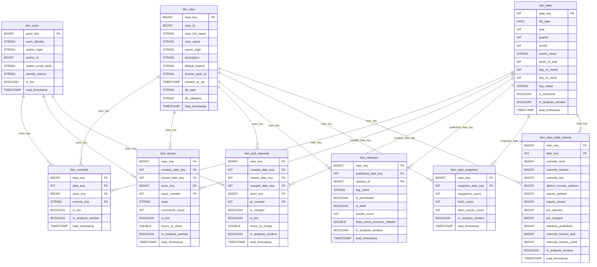

# Gold Layer Data Dictionary — DAV Database Trends

This document defines the physical and semantic schema of the **Gold Layer** (`workspace.gold`) for the DAV Database Trends PySpark Medallion pipeline. The Gold layer implements a dimensional star schema optimized for fast analytical slicing, Power BI reporting, and time-series aggregation.

---

## 1. Dimensional Architecture & Entity Relationship Diagram

The Gold layer models 10 tracked database repositories across relational, document, graph/multi-model, distributed, and vector categories. All base facts link to shared conformant dimensions (`dim_repo`, `dim_date`, `dim_actor`), while the aggregate fact `fact_repo_daily_activity` provides pre-computed rolling velocity over a continuous, dense calendar spine.

---

## 2. Dimension Tables

### 2.1 `gold.dim_repo`
* **Grain:** One row per tracked repository.
* **SCD Strategy:** Slowly Changing Dimension Type 1 (in-place overwrite of mutable metadata).
* **Liquid Clustering:** `CLUSTER BY (repo_key)`

| Column Name | Data Type | Nullable | Description |
|---|---|---|---|
| `repo_key` | `BIGINT` | **No** | Primary Key: Deterministic 64-bit hash (`xxhash64(lower(trim(repo_full_name)))`) |
| `repo_id` | `BIGINT` | Yes | Upstream GitHub repository identifier |
| `repo_full_name` | `STRING` | **No** | Natural Key: Full GitHub slug, e.g., `'surrealdb/surrealdb'` |
| `repo_name` | `STRING` | Yes | Repository short name, e.g., `'surrealdb'` |
| `owner_login` | `STRING` | Yes | GitHub owner organization / user handle |
| `description` | `STRING` | Yes | Repository description from upstream metadata |
| `default_branch` | `STRING` | Yes | Default git branch (e.g., `'main'`, `'master'`) |
| `license_spdx_id` | `STRING` | Yes | Open-source license identifier (e.g., `'Apache-2.0'`, `'PostgreSQL'`) |
| `created_at_utc` | `TIMESTAMP` | Yes | Original repository creation timestamp in UTC |
| `db_type` | `STRING` | **No** | Canonical database type (e.g., `'Vector'`, `'Relational'`, `'Key-Value'`) |
| `db_category` | `STRING` | **No** | Market categorization (`'Established'` vs `'Emerging'`) |
| `load_timestamp` | `TIMESTAMP` | **No** | Medallion ETL processing timestamp in UTC |

---

### 2.2 `gold.dim_date`
* **Grain:** One row per calendar day, spanning **2008-01-01 to 2027-12-31**.
* **Why 2008?** GitHub was founded in April 2008. The GitHub API's `since` filter operates on an item's *last-updated* timestamp, not its creation date. This means issues opened in 2011–2019 and releases published before 2020 may surface in any incremental load whenever they receive a comment or a label change. Extending `dim_date` to 2008-01-01 guarantees that every `fact_issues.created_date_key` and `fact_releases.published_date_key` has a matching row and Quality Gate 2 (referential integrity) passes.
* **Activity Spine Floor:** `fact_repo_daily_activity` cross-joins `dim_repo` × `dim_date` filtered to **≥ 2020-01-01** (`DIM_DATE_ACTIVITY_SPINE_START`), preventing ~43,800 zero-activity rows from being written for the 2008–2019 period.
* **Strategy:** Pre-generated continuous calendar spine.
* **Liquid Clustering:** `CLUSTER BY (date_key)`

| Column Name | Data Type | Nullable | Description |
|---|---|---|---|
| `date_key` | `INT` | **No** | Primary Key: Integer date representation in `YYYYMMDD` format (e.g., `20260401`) |
| `full_date` | `DATE` | **No** | Calendar date object |
| `year` | `INT` | **No** | Calendar year (e.g., `2026`) |
| `quarter` | `INT` | **No** | Calendar quarter (`1` to `4`) |
| `month` | `INT` | **No** | Month index (`1` to `12`) |
| `month_name` | `STRING` | **No** | English month name (e.g., `'April'`) |
| `week_of_year` | `INT` | **No** | ISO-8601 week number (`1` to `53`) |
| `day_of_month` | `INT` | **No** | Day index of month (`1` to `31`) |
| `day_of_week` | `INT` | **No** | Day of week (`1` = Sunday through `7` = Saturday) |
| `day_name` | `STRING` | **No** | English day name (e.g., `'Monday'`) |
| `is_weekend` | `BOOLEAN` | **No** | True if Saturday or Sunday |
| `in_analysis_window` | `BOOLEAN` | **No** | True if date falls within the configured analysis window (default `2026-04-01` to `2026-09-30`) |
| `load_timestamp` | `TIMESTAMP` | **No** | Medallion ETL processing timestamp in UTC |

---

### 2.3 `gold.dim_actor`
* **Grain:** One row per unique contributor identity.
* **SCD Strategy:** Slowly Changing Dimension Type 1.
* **Identity Resolution:** Coalesces `author_login` → salted `author_email_hash` → `'unknown'`.
* **Liquid Clustering:** `CLUSTER BY (actor_key)`

| Column Name | Data Type | Nullable | Description |
|---|---|---|---|
| `actor_key` | `BIGINT` | **No** | Primary Key: Deterministic 64-bit hash (`xxhash64(actor_identity)`) |
| `actor_identity` | `STRING` | **No** | Unified unique identity token (`login:xxx`, `email_hash:xxx`, or `'unknown'`) |
| `author_login` | `STRING` | Yes | GitHub username (null for email-only commit authors) |
| `author_id` | `BIGINT` | Yes | Upstream GitHub account identifier |
| `author_email_hash` | `STRING` | Yes | Salted SHA-256 hash of author email (raw emails strictly dropped) |
| `identity_source` | `STRING` | **No** | Source token indicator (`'login'`, `'email_hash'`, or `'unknown'`) |
| `is_bot` | `BOOLEAN` | **No** | Classification flag indicating CI/CD or automation bot |
| `load_timestamp` | `TIMESTAMP` | **No** | Medallion ETL processing timestamp in UTC |

---

## 3. Base Fact Tables

### 3.1 `gold.fact_commits`
* **Grain:** One row per commit.
* **Primary Key:** `(repo_key, commit_sha)`
* **Liquid Clustering:** `CLUSTER BY (repo_key, date_key)`

| Column Name | Data Type | Nullable | Description |
|---|---|---|---|
| `repo_key` | `BIGINT` | **No** | Foreign Key referencing `dim_repo.repo_key` |
| `date_key` | `INT` | **No** | Foreign Key referencing `dim_date.date_key` (commit authored date) |
| `actor_key` | `BIGINT` | **No** | Foreign Key referencing `dim_actor.actor_key` |
| `commit_sha` | `STRING` | **No** | Git commit SHA-1 hash (40 hex characters) |
| `is_bot` | `BOOLEAN` | **No** | True if commit authored by identified bot |
| `in_analysis_window` | `BOOLEAN` | **No** | True if authored between `2026-04-01` and `2026-09-30` |
| `load_timestamp` | `TIMESTAMP` | **No** | Medallion ETL processing timestamp in UTC |

---

### 3.2 `gold.fact_issues`
* **Grain:** One row per true issue (pull requests excluded).
* **Primary Key:** `(repo_key, issue_number)`
* **Liquid Clustering:** `CLUSTER BY (repo_key, created_date_key)`

| Column Name | Data Type | Nullable | Description |
|---|---|---|---|
| `repo_key` | `BIGINT` | **No** | Foreign Key referencing `dim_repo.repo_key` |
| `created_date_key` | `INT` | **No** | Foreign Key referencing `dim_date.date_key` (issue created date) |
| `closed_date_key` | `INT` | Yes | Foreign Key referencing `dim_date.date_key` (null if open) |
| `actor_key` | `BIGINT` | **No** | Foreign Key referencing `dim_actor.actor_key` |
| `issue_number` | `INT` | **No** | GitHub issue sequence number |
| `state` | `STRING` | **No** | Lifecycle state (`'open'` or `'closed'`) |
| `comments_count` | `INT` | **No** | Total comment count on issue |
| `is_bot` | `BOOLEAN` | **No** | True if issue submitted by automation bot |
| `hours_to_close` | `DOUBLE` | Yes | Elapsed hours from creation to closure (null if open, non-negative) |
| `in_analysis_window` | `BOOLEAN` | **No** | True if created between `2026-04-01` and `2026-09-30` |
| `load_timestamp` | `TIMESTAMP` | **No** | Medallion ETL processing timestamp in UTC |

---

### 3.3 `gold.fact_pull_requests`
* **Grain:** One row per pull request.
* **Primary Key:** `(repo_key, pr_number)`
* **Liquid Clustering:** `CLUSTER BY (repo_key, created_date_key)`

| Column Name | Data Type | Nullable | Description |
|---|---|---|---|
| `repo_key` | `BIGINT` | **No** | Foreign Key referencing `dim_repo.repo_key` |
| `created_date_key` | `INT` | **No** | Foreign Key referencing `dim_date.date_key` (PR open date) |
| `closed_date_key` | `INT` | Yes | Foreign Key referencing `dim_date.date_key` (null if open) |
| `merged_date_key` | `INT` | Yes | Foreign Key referencing `dim_date.date_key` (null if unmerged) |
| `actor_key` | `BIGINT` | **No** | Foreign Key referencing `dim_actor.actor_key` |
| `pr_number` | `INT` | **No** | GitHub pull request sequence number |
| `is_merged` | `BOOLEAN` | **No** | True if pull request was successfully merged |
| `is_bot` | `BOOLEAN` | **No** | True if authored by automation bot |
| `hours_to_merge` | `DOUBLE` | Yes | Elapsed hours from open to merge (null if unmerged, non-negative) |
| `in_analysis_window` | `BOOLEAN` | **No** | True if opened between `2026-04-01` and `2026-09-30` |
| `load_timestamp` | `TIMESTAMP` | **No** | Medallion ETL processing timestamp in UTC |

---

### 3.4 `gold.fact_releases`
* **Grain:** One row per release.
* **Primary Key:** `(repo_key, release_id)`
* **Liquid Clustering:** `CLUSTER BY (repo_key, published_date_key)`

| Column Name | Data Type | Nullable | Description |
|---|---|---|---|
| `repo_key` | `BIGINT` | **No** | Foreign Key referencing `dim_repo.repo_key` |
| `published_date_key` | `INT` | **No** | Foreign Key referencing `dim_date.date_key` |
| `release_id` | `BIGINT` | **No** | Upstream GitHub release identifier |
| `tag_name` | `STRING` | Yes | Git release tag name |
| `is_prerelease` | `BOOLEAN` | **No** | True if release tagged as pre-release / release-candidate |
| `is_draft` | `BOOLEAN` | **No** | True if draft release |
| `assets_count` | `INT` | **No** | Count of compiled binary assets attached to release |
| `days_since_previous_release` | `DOUBLE` | Yes | Elapsed days since preceding release of same repo (null for first) |
| `in_analysis_window` | `BOOLEAN` | **No** | True if published between `2026-04-01` and `2026-09-30` |
| `load_timestamp` | `TIMESTAMP` | **No** | Medallion ETL processing timestamp in UTC |

---

### 3.5 `gold.fact_repo_snapshot`
* **Grain:** `(repo_key, snapshot_date_key)`
* **Primary Key:** `(repo_key, snapshot_date_key)`
* **Liquid Clustering:** `CLUSTER BY (repo_key, snapshot_date_key)`

| Column Name | Data Type | Nullable | Description |
|---|---|---|---|
| `repo_key` | `BIGINT` | **No** | Foreign Key referencing `dim_repo.repo_key` |
| `snapshot_date_key` | `INT` | **No** | Foreign Key referencing `dim_date.date_key` |
| `stargazers_count` | `INT` | Yes | Cumulative star count as of snapshot date |
| `forks_count` | `INT` | Yes | Cumulative fork count as of snapshot date |
| `open_issues_count` | `INT` | Yes | Open issues count reported by GitHub metadata as of snapshot date |
| `in_analysis_window` | `BOOLEAN` | **No** | True if snapshot date falls within analysis window |
| `load_timestamp` | `TIMESTAMP` | **No** | Medallion ETL processing timestamp in UTC |

---

## 4. Aggregate Fact Table

### 4.1 `gold.fact_repo_daily_activity`
* **Grain:** `(repo_key, date_key)` — exactly one row per repository per calendar day.
* **Dense Calendar Spine:** Guarantees zero activity days are materialized with 0 counts.
* **Liquid Clustering:** `CLUSTER BY (repo_key, date_key)`

| Column Name | Data Type | Nullable | Description |
|---|---|---|---|
| `repo_key` | `BIGINT` | **No** | Foreign Key referencing `dim_repo.repo_key` |
| `date_key` | `INT` | **No** | Foreign Key referencing `dim_date.date_key` |
| `commits_total` | `BIGINT` | **No** | Total commits authored on day |
| `commits_human` | `BIGINT` | **No** | Human-authored commits on day (excluding bots) |
| `commits_bot` | `BIGINT` | **No** | Bot-authored commits on day |
| `distinct_human_authors` | `BIGINT` | **No** | Count of unique human contributors active on day |
| `issues_opened` | `BIGINT` | **No** | True issues opened on day |
| `issues_closed` | `BIGINT` | **No** | Issues closed on day |
| `prs_opened` | `BIGINT` | **No** | Pull requests opened on day |
| `prs_merged` | `BIGINT` | **No** | Pull requests merged on day |
| `releases_published` | `BIGINT` | **No** | Releases published on day |
| `commits_human_4wk` | `BIGINT` | **No** | Rolling 28-day human commit velocity sum over dense calendar spine |
| `commits_human_12wk` | `BIGINT` | **No** | Rolling 84-day human commit velocity sum over dense calendar spine |
| `in_analysis_window` | `BOOLEAN` | **No** | True if date falls within `2026-04-01` to `2026-09-30` |
| `load_timestamp` | `TIMESTAMP` | **No** | Medallion ETL processing timestamp in UTC |

---

## 5. Audit & Operations Objects

### 5.1 `gold.audit_gold_reconciliation`
Tracks exact row parity between Silver source tables and Gold target tables.
* `table_name`: Name of target Gold table.
* `silver_source_rows`: Count of source records in Silver.
* `gold_target_rows`: Count of loaded records in Gold.
* `delta_rows`: `gold_target_rows - silver_source_rows` (must strictly be 0 for passing gate).
* `status`: `'PASS'` or `'FAIL'`.
* `check_timestamp`: Audit check execution timestamp.

### 5.2 `gold.audit_pipeline_runs` (View)
User-friendly reporting view over `ops.pipeline_execution_logs`:
* `log_id`, `run_date`, `layer`, `parameter`, `status`, `duration_seconds`, `rows_inserted`, `rows_updated`, `rows_aggregated`, `error_message`.

### 5.3 `gold.audit_quarantine_summary` (View)
Aggregated quarantine reporting view over `ops.silver_quarantine`:
* `quarantine_date`, `layer`, `entity`, `repo_full_name`, `rejection_reason`, `quarantine_count`.
